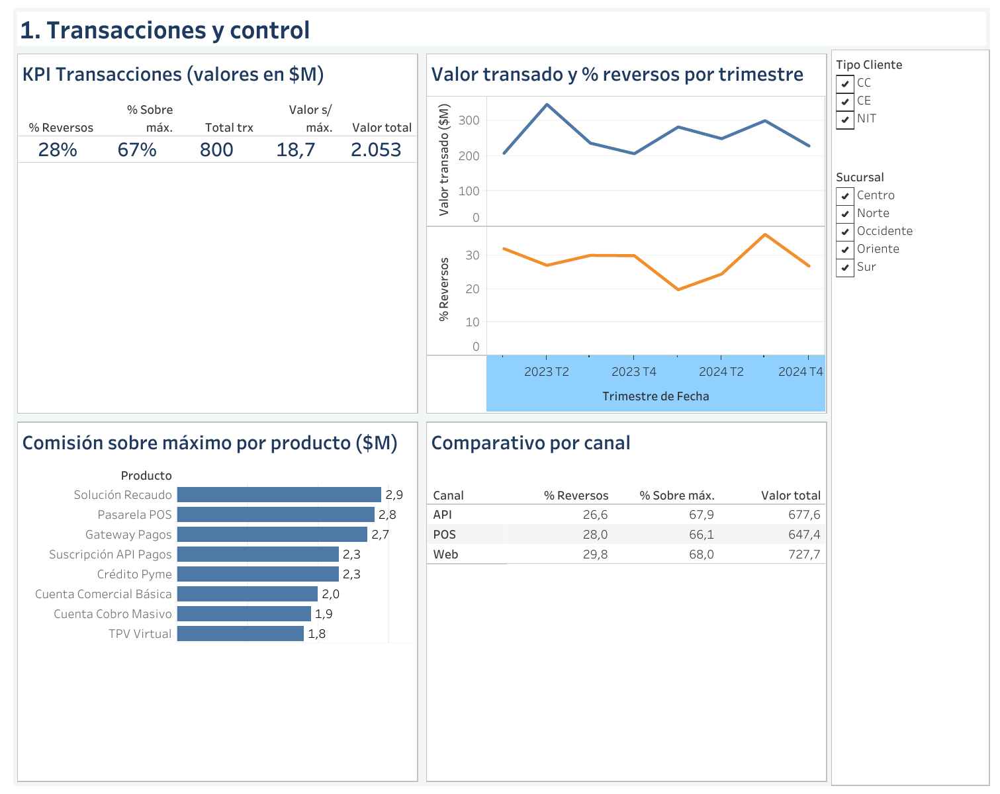
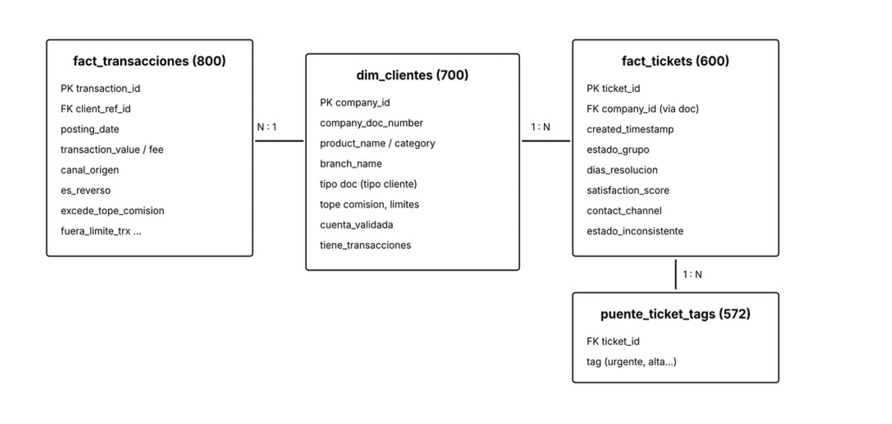
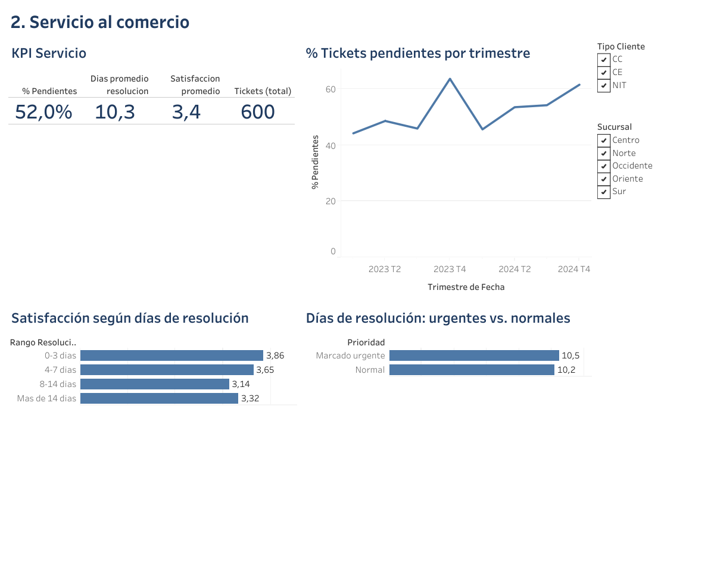
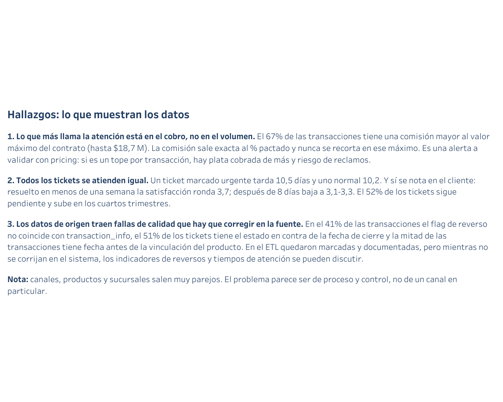

<h1 align="center">Análisis del proceso transaccional y de servicio a comercios</h1>

<p align="center">
  
  
  
  
</p>

<p align="center"><b>ETL · Modelado dimensional · Tablero · Hallazgos y recomendaciones</b></p>

<p align="center"></p>

Proyecto de análisis de datos sobre un escenario simulado de una entidad financiera que quiere mejorar su vertical de servicio y experiencia transaccional. Integré tres fuentes en formatos distintos, las limpié y modelé con Python, construí un tablero en Tableau y resumí los hallazgos y recomendaciones en un documento corto.

**Herramientas:** Python (pandas) · Tableau · modelado dimensional (esquema estrella)

---

## Resumen

El volumen transaccional es estable y ningún canal, producto o sucursal se aleja mucho de los demás. **Los problemas aparecen en los controles, no en el volumen:**

| Indicador | Resultado |
|---|---|
| Valor transado | $2.052 millones (800 transacciones) |
| Comisiones cobradas | $31,2 millones (IVA del 19% cuadra en todas) |
| Transacciones con comisión por encima del máximo del contrato | 67% (539) |
| Transacciones con reverso | 28% |
| Comercios vinculados sin ninguna transacción | 210 de 700 (30%) |
| Comercios con cuenta bancaria sin validar | 337 de 700 (48%) |
| Tickets pendientes | 52% (sube a 62–64% en los cuartos trimestres) |
| Tiempo promedio de resolución | 10,3 días |
| Satisfacción promedio | 3,4 / 5 |

### Hallazgos principales

1. **El foco está en el cobro.** La comisión se calcula exacta al porcentaje pactado, pero nunca se recorta en el `max_commission_value` del contrato. Si ese campo es un tope por transacción, habría hasta $18,7 M cobrados de más. Lo dejé como supuesto por validar.
2. **No hay priorización en la atención.** Un ticket urgente tarda 10,5 días y uno normal 10,2. La satisfacción baja de ~3,7 a 3,1–3,3 cuando la resolución pasa de una semana.
3. **Hay fallas de calidad en los datos de origen.** En el 41% de las transacciones el flag de reverso contradice `transaction_info`, el 51% de los tickets tiene el estado en contra de la fecha de cierre y la mitad de las transacciones tiene fecha anterior a la vinculación.

El detalle completo y las recomendaciones están en [docs/1_Conclusiones.pdf](docs/1_Conclusiones.pdf).

---

## Estructura del repositorio

```
├── datos/
│   ├── originales/        # Fuentes del caso: CSV, TXT (separador |) y JSON anidado
│   └── limpios/           # Tablas del modelo y vistas para Tableau (salida del ETL)
├── etl/
│   ├── etl_caso_practico.py   # Extracción, transformación, banderas de control y carga
│   └── vistas_tableau.py      # Vistas planas para Tableau
├── dashboard/             # Capturas y PDF del tablero (3 vistas)
├── docs/
│   ├── 0_Enunciado_caso_practico.pdf
│   ├── 1_Conclusiones.pdf
│   ├── 2_Metodologia_ETL_y_Modelo_de_Datos.pdf
│   └── modelo_de_datos.png
└── requirements.txt
```

## Cómo reproducirlo

```bash
pip install -r requirements.txt
python etl/etl_caso_practico.py datos/originales datos/limpios
python etl/vistas_tableau.py datos/limpios
```

El primer script genera las cuatro tablas del modelo y valida que no haya ids duplicados y que todas las transacciones y tickets crucen con un comercio. El segundo genera las dos vistas planas que usa el tablero.

---

## Proceso ETL

**Extracción**

| Fuente | Formato | Registros |
|---|---|---|
| `clientes_productos` | CSV | 700 comercios |
| `transacciones` | TXT separado por `\|` | 800 transacciones (ene 2023 – dic 2024) |
| `tickets_usuarios` | JSON anidado | 600 tickets |

**Transformaciones principales**

- Documentos y cuentas leídos como texto, porque son identificadores.
- Eliminación de datos sensibles que no aportan al análisis (cuenta bancaria, documento del titular, teléfono).
- Aplanado del JSON (`form_details`) y separación de los `tags` en una tabla puente.
- Agrupación del estado del ticket: `open`/`pending` → Pendiente; `closed`/`solved` → Resuelto.
- Días de resolución calculados solo para tickets resueltos con fecha de cierre.
- **Banderas de control** cruzando cada transacción con las condiciones del contrato del comercio: comisión sobre el máximo, valor fuera de límites, transacción antes de la vinculación, abono a cuenta sin validar y reverso inconsistente.

## Modelo de datos



Esquema estrella con el comercio en el centro:

- **dim_clientes:** una fila por comercio, con producto, sucursal, tipo de cliente y condiciones del contrato.
- **fact_transacciones:** se une por `client_ref_id = company_id`.
- **fact_tickets:** el JSON solo trae el documento del comercio, así que en el ETL le asigné `company_id` cruzando por documento. Así las dos tablas de hechos comparten la misma llave.
- **puente_ticket_tags:** un ticket puede tener varias etiquetas. Separarlas evita duplicar tickets e inflar los conteos.

Los supuestos y decisiones están documentados en [docs/2_Metodologia_ETL_y_Modelo_de_Datos.pdf](docs/2_Metodologia_ETL_y_Modelo_de_Datos.pdf).

---

## Tablero

El tablero se construyó en Tableau y tiene tres vistas. También está completo en PDF: [dashboard/tablero_completo.pdf](dashboard/tablero_completo.pdf).

**1. Transacciones y control**


**2. Servicio al comercio**



**3. Hallazgos**



---

## Recomendaciones

1. Validar con el área de pricing cómo funciona el máximo de comisión y, si es un tope por transacción, revisar las 539 transacciones afectadas.
2. Bloquear o alertar abonos a cuentas sin validar y hacer una campaña para validar las 337 cuentas pendientes.
3. Definir ANS por prioridad y tipo de ticket, con seguimiento semanal del backlog y refuerzo en el último trimestre.
4. Hacer un plan de activación para los 210 comercios sin transacciones, empezando por los 123 que ya tienen tickets abiertos.
5. Agregar validaciones en la carga de datos: una sola fuente para reversos, estado del ticket amarrado a la fecha de cierre y ninguna transacción anterior a la vinculación.

---

*Los datos corresponden a un escenario simulado y no representan clientes reales.*

**Autor:** Leonardo Soto · [LinkedIn](https://www.linkedin.com/in/leonardo-soto-berrio/) · [GitHub](https://github.com/Lasotoberrio)
